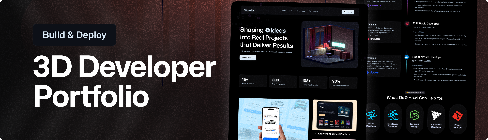
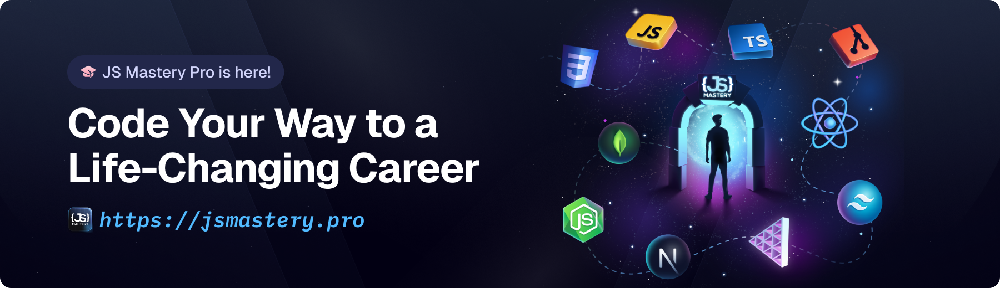

<div align="center">
  <br />
  
  <br />

  <div>
    
    
    
    
    
    
    
  </div>

  <h1 align="center">Interactive 3D Portfolio</h1>

  <p align="center">
    A visually rich, fully responsive personal portfolio built with React 19, Three.js, and GSAP — featuring interactive 3D models, scroll-driven animations, and a live contact form.
  </p>
</div>

---

## 📋 Table of Contents

1. [Overview](#overview)
2. [Features](#features)
3. [Tech Stack](#tech-stack)
4. [Project Structure](#project-structure)
5. [Sections](#sections)
6. [Getting Started](#getting-started)
7. [Environment Variables](#environment-variables)
8. [Available Scripts](#available-scripts)
9. [Known Issues & Improvements](#known-issues--improvements)

---

## Overview

This is a modern, interactive 3D developer portfolio website sample. The portfolio showcases work experience, a curated tech stack with interactive 3D models, live client testimonials, featured projects, and a fully functional contact form powered by EmailJS.

The entire site is animated using **GSAP** with scroll-triggered effects and features multiple **React Three Fiber** canvases loading real `.glb` 3D models with HDR environment lighting.

---

## ✨ Features

- 🏠 **Hero Section** — Animated text loop with word cycling, a GSAP fade-in headline, and an interactive 3D room model
- 📊 **Animated Counters** — Scroll-triggered stats (years of experience, clients, projects, retention rate)
- 🖼️ **Project Showcase** — Highlighted projects with responsive layouts and direct links
- 🏢 **Logo Marquee** — Infinitely scrolling company/client logos
- 🃏 **Feature Cards** — Key selling points with SVG illustrations
- 💼 **Work Experience** — Timeline-style experience section with GlowCard spotlight effect
- 🧰 **Tech Stack** — Interactive 3D model cards for each technology (React, Python, Node.js, Three.js, Git, and more) with HDR city environment reflections
- 💬 **Testimonials** — Client review cards with glow spotlight mouse effect
- 📬 **Contact Form** — EmailJS-powered form with success confirmation (auto-dismissing), in-form error feedback, and a live 3D computer model
- 🦶 **Footer** — Social links and copyright
- 📱 **Fully Responsive** — Mobile-first design using Tailwind CSS v4

---

## 🛠 Tech Stack

| Category         | Technology                                      |
| ---------------- | ----------------------------------------------- |
| Framework        | React 19                                        |
| Language         | TypeScript 6                                    |
| 3D Rendering     | Three.js, React Three Fiber, React Three Drei   |
| Post-processing  | `@react-three/postprocessing`, `postprocessing` |
| Animation        | GSAP 3, `@gsap/react`                           |
| Styling          | Tailwind CSS v4 (CSS-first config)              |
| Build Tool       | Vite 8                                          |
| Email            | EmailJS (`@emailjs/browser`)                    |
| Counter          | `react-countup`                                 |
| Responsive Hooks | `react-responsive`                              |
| Package Manager  | pnpm                                            |

---

## 📁 Project Structure

```
portfolio_one/
├── public/
│   ├── hdr/
│   │   └── potsdamer_platz_1k.hdr      # Local HDR environment map
│   ├── images/                          # All static images, SVGs, and logos
│   └── models/                          # GLTF/GLB 3D model assets
│       ├── optimized-room.glb           # Hero 3D room scene
│       ├── computer-optimized-transformed.glb
│       ├── react_logo-transformed.glb
│       ├── python-transformed.glb
│       ├── node-transformed.glb
│       ├── three.js-transformed.glb
│       └── git-svg-transformed.glb
├── src/
│   ├── components/
│   │   ├── models/
│   │   │   ├── hero_models/
│   │   │   │   ├── HeroExperience.tsx   # Main hero Canvas
│   │   │   │   ├── HeroLights.tsx       # Three-point lighting rig
│   │   │   │   ├── Room.tsx             # 3D room model (GLTF)
│   │   │   │   └── Particles.tsx        # Particle system
│   │   │   ├── contact/
│   │   │   │   ├── ContactExperience.tsx
│   │   │   │   └── Computer.tsx         # 3D computer model (GLTF)
│   │   │   ├── tech_logos/
│   │   │   │   └── TechIconCardExperience.tsx
│   │   │   └── types.ts                 # Shared GLTF type helpers
│   │   ├── AnimatedCounter.tsx
│   │   ├── Button.tsx
│   │   ├── GlowCard.tsx                 # Mouse spotlight glow card
│   │   ├── LogoIcon.tsx
│   │   ├── NavBar.tsx
│   │   └── TitleHeader.tsx
│   ├── constants/
│   │   └── index.ts                     # All site content/data
│   ├── sections/
│   │   ├── Hero.tsx
│   │   ├── ShowcaseSection.tsx
│   │   ├── LogoShowcase.tsx
│   │   ├── FeatureCards.tsx
│   │   ├── Experience.tsx
│   │   ├── TechStack.tsx
│   │   ├── Testimonials.tsx
│   │   ├── Contact.tsx
│   │   └── Footer.tsx
│   ├── App.tsx
│   ├── main.tsx
│   └── index.css                        # Global styles & Tailwind v4 theme
├── .env.example                         # Environment variable template
├── index.html
├── vite.config.ts
├── tsconfig.json
└── package.json
```

---

## 🗂 Sections

| Section           | Description                                                                       |
| ----------------- | --------------------------------------------------------------------------------- |
| **NavBar**        | Fixed navigation with smooth scroll links                                         |
| **Hero**          | Animated headline, animated word slider, 3D interactive room, stats counters      |
| **Showcase**      | Featured project highlights                                                       |
| **Logo Showcase** | Infinite-scroll marquee of partner/client logos                                   |
| **Feature Cards** | What I bring to the table — key capabilities                                      |
| **Experience**    | Work history timeline with GlowCard interactive reviews                           |
| **Tech Stack**    | 3D animated tech icon cards (React, Python, Node, Three.js, Git, Interactive Dev) |
| **Testimonials**  | Client reviews with spotlight mouse glow effect                                   |
| **Contact**       | EmailJS form with inline success/error feedback + 3D computer model               |
| **Footer**        | Social media links and copyright                                                  |

---

## 🚀 Getting Started

### Prerequisites

- **Node.js** `>=18.x`
- **pnpm** `>=9.x` — install with `npm install -g pnpm`

### Installation

1. **Clone the repository:**

   ```bash
   git clone https://github.com/Mojahedhu/3D_portfolio.git
   cd 3D_portfolio
   ```

2. **Install dependencies:**

   ```bash
   pnpm install
   ```

3. **Set up environment variables:**

   ```bash
   cp .env.example .env
   ```

   Then fill in your EmailJS credentials (see [Environment Variables](#environment-variables)).

4. **Start the development server:**
   ```bash
   pnpm dev
   ```
   Open [http://localhost:5173](http://localhost:5173) in your browser.

---

## 🔑 Environment Variables

Create a `.env` file in the root of the project based on `.env.example`:

```env
VITE_APP_EMAILJS_SERVICE_ID=your_service_id
VITE_APP_EMAILJS_TEMPLATE_ID=your_template_id
VITE_APP_EMAILJS_PUBLIC_KEY=your_public_key
```

To get these values:

1. Create a free account at [emailjs.com](https://www.emailjs.com/)
2. Create an **Email Service** and copy the **Service ID**
3. Create an **Email Template** and copy the **Template ID**
4. Copy your **Public Key** from the Account tab

> ⚠️ Never commit your `.env` file. It is already listed in `.gitignore`.

---

## 📜 Available Scripts

| Command        | Description                                     |
| -------------- | ----------------------------------------------- |
| `pnpm dev`     | Start Vite development server with HMR          |
| `pnpm build`   | Type-check with `tsc` then build for production |
| `pnpm preview` | Preview the production build locally            |
| `pnpm lint`    | Run ESLint across all source files              |

---

## 🐛 Known Issues & Improvements

### 3D / HDR

- The HDR environment map (`potsdamer_platz_1k.hdr`) is committed to the repository. For large teams, consider serving it from a CDN or using Git LFS.

---

## The original app source:

<div align="center">
  
  <br/>
  <p>Built with ❤️ by <strong>Mojahed</strong></p>
</div>
